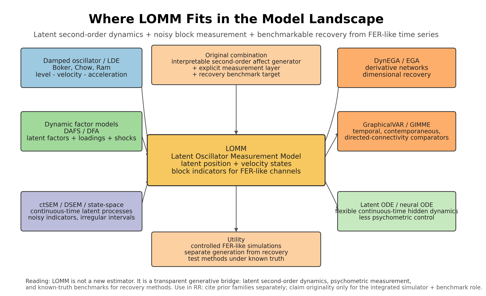

# LOMM model landscape review

Date: 2026-05-16

Source files: `paper/gdlo_working_note.tex`, `paper-plan.md`, `claims-ledger.md`, `analysis-map.md`, and `style-guide.md`.

Visual map: `paper/figures/lomm_model_landscape_map.png` and `paper/figures/lomm_model_landscape_map.svg`.

## Bottom line

The Latent Oscillator Measurement Model (LOMM) is best framed as an **interpretable generative bridge** between psychological latent differential-equation models, psychometric measurement models, and recovery-method benchmarks for FER-like time series. Its originality is not that it invents second-order dynamics, latent variables, measurement models, or network recovery. Its contribution is the **integrated use of these pieces** for a specific methodological problem: generating multivariate, noisy, FER-like emotion-score panels with known latent dimensionality and then asking whether methods such as DynEGA, GraphicalVAR, and bounded GIMME recover that latent organization.

The clean manuscript claim is:

> LOMM combines low-dimensional second-order latent expressive dynamics with a noisy block measurement model, producing controlled FER-like time series for empirical-realism checks and dimensional-recovery benchmarks.

Kankaanpää et al. (2026) is a high-priority citation for this framing. It shows, in GVAR and panelGVAR simulations, that measurement error reduces true-estimated network correspondence and edge sensitivity, and that single-indicator dynamic networks are especially vulnerable. For LOMM, the relevance is not that the paper supplies a competing generator; it supports the decision to treat observed emotion channels as noisy indicators of latent expressive processes and to keep measurement quality explicit in recovery benchmarks.

Avoid claiming that LOMM is a general replacement for ctSEM, DSEM, latent ODEs, GraphicalVAR, or GIMME. It is better treated as a transparent, psychology-facing simulator and benchmark generator.

## Map of related model families



## Thematic review

### 1. Psychological oscillator and latent differential-equation models

The closest conceptual ancestor is the damped oscillator / latent differential-equation tradition in psychology. This line of work treats psychological processes as dynamic systems whose present state, velocity, and acceleration jointly describe self-regulation, return to equilibrium, or instability. Boker-style latent differential equation models and emotion-as-thermostat examples make this language natural for affective dynamics: emotion is not only a level but also a rate of change and a tendency to bend back, persist, or amplify.

LOMM inherits the **second-order interpretive grammar** from this family. Its latent state equation explicitly separates position and velocity and allows parameters to be read as position feedback and velocity feedback. This is useful for emotion-score series because short clips can contain inertia, recovery, persistence, or oscillatory-looking behavior that first-order autoregression alone does not describe cleanly.

What LOMM adds relative to the classic oscillator literature is not a new dynamical law. It adds an explicit **FER-like measurement layer** and a recovery-benchmark use case. In classic oscillator applications, the goal is often to estimate the dynamical parameters of an observed or latent process. In LOMM, the current manuscript goal is more modest and more methodological: generate known latent trajectories, produce noisy observed emotion channels, and evaluate whether downstream dimensional methods recover the intended latent organization.

### 2. Dynamic factor and DAFS-style measurement models

Dynamic factor models and direct autoregressive factor score (DAFS) models are the closest psychometric relatives. They already combine latent factors, factor loadings, temporal evolution, and shock/error terms. The DSEM paper explicitly situates dynamic structural equation modeling as extending dynamic factor modeling for intensive longitudinal data and references Molenaar and Nesselroade-style dynamic factor models.

LOMM borrows this psychometric intuition: observed variables should not be treated as independent dynamical systems when they can be noisy indicators of fewer latent tendencies. The block loading matrix in LOMM makes that assumption explicit. This is central for FER-like outputs, where many observed channels can move together because they are alternative labels or manifestations of the same broader expressive tendency.

LOMM differs from dynamic factor models in two ways. First, it uses a **second-order continuous-time generator** rather than a conventional discrete autoregressive factor process. Second, it is built as a **simulation and validation scaffold** for method comparison, not primarily as an estimator for empirical latent factor scores.

### 3. ctSEM, DSEM, and state-space SEM

Continuous-time SEM and dynamic SEM provide the broad statistical home for latent dynamic systems with noisy indicators. The ctsem package paper states that continuous-time models use stochastic differential equations to estimate underlying continuous processes and can handle irregular measurement occasions; it also notes that ctsem can estimate multiple latent processes measured by noisy indicators and can model oscillating processes. DSEM similarly combines multilevel modeling, time-series modeling, SEM, and time-varying effects for intensive longitudinal data.

LOMM should be positioned as **simpler and narrower** than ctSEM/DSEM. Those frameworks are general-purpose estimation systems. LOMM is an intentionally restricted generator:

- uncoupled latent factors in the current implementation,
- simple block measurement structure,
- controlled simulation conditions,
- direct connection to recovery benchmarks.

This restriction is a feature for the manuscript. It makes the data-generating truth auditable. The question is not "can we estimate every possible continuous-time SEM?" The question is "under known latent second-order dynamics and noisy FER-like indicators, which recovery methods find the right dimensional organization?"

### 4. Network psychometrics and dynamic recovery methods

DynEGA, GraphicalVAR, and GIMME are not competitors to LOMM as data-generating models. They are recovery or comparator methods.

Kankaanpää et al. (2026) should be used here as the current network-psychometrics measurement-error bridge. They compare single-indicator dynamic networks with multiple-indicator approaches, including latent variables, plausible values, factor scores, and average scores. Their simulations show that measurement error lowers edge-weight recovery and sensitivity, with the single-indicator approach most affected. For time-series temporal networks, factor-score and average-score approaches performed especially well; for panel settings, plausible values were generally strongest. This directly supports LOMM's psychometric premise: noisy observed nodes should not be treated as clean dynamic variables when they may be indicators of fewer latent processes.

DynEGA is especially important because its documentation describes dynamic factors in multivariate time series and emphasizes that it estimates factor structure by modeling how variables change together, using derivatives estimated through generalized local linear approximation. That is directly aligned with LOMM's goal: produce multivariate series where latent dimensions create coordinated change, then ask whether a derivative-network approach recovers those dimensions.

GraphicalVAR and GIMME sit differently. GraphicalVAR estimates temporal and contemporaneous network relations; GIMME searches for group-level and person-specific directed paths. They are useful comparators because they represent alternative dynamic-structure recovery philosophies. But they do not by themselves provide the same known-truth latent measurement generator. In the current LOMM paper, this distinction should be explicit:

- **LOMM:** generative simulator with known latent structure.
- **DynEGA / GraphicalVAR / GIMME:** recovery methods evaluated on LOMM panels.

This distinction also prevents over-reading the GraphicalVAR comparator. Kankaanpää et al. show that dynamic-network recovery can be sensitive to measurement error unless the measurement layer is modeled or summarized appropriately. In the LOMM manuscript, GraphicalVAR remains useful as a recovery comparator, but LOMM's explicit measurement layer is part of the data-generating problem being benchmarked rather than a feature GraphicalVAR itself solves.

### 5. Modern latent ODE and neural continuous-time models

Latent ODE, ODE-RNN, and GRU-ODE-Bayes models show how machine learning handles irregular time series with continuous-time hidden dynamics. These models are more flexible than LOMM and can be strong predictive tools. For example, Latent ODEs model continuous-time hidden dynamics with ODEs and can handle arbitrary time gaps. GRU-ODE-Bayes combines a continuous-time GRU with Bayesian observation updates for sporadically observed multivariate time series.

LOMM is not trying to win on predictive flexibility. Its advantage is **interpretability and psychometric control**:

- parameters have simple dynamical interpretations,
- measurement loadings are explicit,
- latent dimensionality is known by construction,
- generated data are designed for method evaluation.

The originality claim should therefore contrast LOMM with latent ODEs carefully: modern neural ODE models are more general and often more expressive, but LOMM is more transparent and better suited to a quantitative-methods paper about dimensional recovery in FER-like psychological time series.

## Utility of LOMM

1. **Known-truth benchmarking.** LOMM gives the analyst a known number of latent dimensions, known measurement blocks, known noise levels, and known dynamical regimes. This is exactly what is needed for a recovery benchmark.

2. **Separation of generation and recovery.** The model generates the data; DynEGA, GraphicalVAR, and GIMME recover structure. This prevents the paper from confusing a data-generating assumption with a recovery method.

3. **Psychology-readable dynamics.** Second-order latent trajectories make it possible to discuss persistence, return, acceleration, damping, and finite-horizon amplification in terms that are familiar to dynamical-systems psychology.

4. **FER-like measurement realism.** The block measurement model reflects the fact that observed emotion labels are noisy indicators of fewer latent expressive tendencies. This is more plausible than treating each FER output as a separate standalone process.

5. **Empirical-realism calibration.** The retained-100 OpenAI-large checks can be framed as posterior-predictive-style evidence that LOMM approximates selected empirical time-series properties without claiming full distributional equivalence.

6. **Measurement-error benchmark discipline.** Kankaanpää et al. (2026) make clear that measurement error is not a cosmetic nuisance in dynamic networks; it changes edge recovery. LOMM can therefore justify keeping loading strength, measurement error, and observed-vs-latent recovery separate in the benchmark interpretation.

## Originality statement for the manuscript

Strong version, still defensible:

> LOMM is original as a transparent, psychology-facing generative benchmark for FER-like emotion time series: it combines interpretable second-order latent dynamics with an explicit psychometric measurement layer and uses the resulting known-truth panels to evaluate dimensional-recovery methods.

Narrower version for methods section:

> LOMM adapts the oscillator tradition to a multivariate measurement setting by treating observed emotion channels as noisy indicators of latent expressive trajectories rather than as independent dynamical variables.

What not to claim:

- Do not claim LOMM is the first latent dynamic model.
- Do not claim LOMM replaces ctSEM, DSEM, or latent ODEs.
- Do not claim it proves zero-shot FER validity.
- Do not claim full empirical realism; the current evidence supports partial realism only.

## Suggested paragraph for the RR manuscript

LOMM sits at the intersection of three established traditions. From latent differential-equation and oscillator models, it takes the idea that psychological processes can be represented by level, velocity, and acceleration rather than by static scores alone. From dynamic factor and state-space SEM models, it takes the idea that observed variables are noisy indicators of lower-dimensional latent processes. From network psychometrics, it takes the practical recovery question: can a method such as DynEGA recover the dimensional organization of multivariate time series when the data-generating structure is known? The contribution of LOMM is to combine these elements in a transparent generator for FER-like emotion-score series, making it possible to evaluate dimensional-recovery methods under controlled dynamic and measurement conditions while retaining a psychology-readable interpretation of the latent process.

## Reference list

- Asparouhov, T., Hamaker, E. L., & Muthen, B. (2018). Dynamic Structural Equation Models. *Structural Equation Modeling: A Multidisciplinary Journal, 25*(3), 359-388. https://doi.org/10.1080/10705511.2017.1406803
- Brouwer, E. D., Simm, J., Arany, A., & Moreau, Y. (2019). GRU-ODE-Bayes: Continuous modeling of sporadically-observed time series. *NeurIPS 2019*. https://arxiv.org/abs/1905.12374
- Driver, C. C., Oud, J. H. L., & Voelkle, M. C. (2017). Continuous Time Structural Equation Modeling with R Package ctsem. *Journal of Statistical Software, 77*(5), 1-35. https://doi.org/10.18637/jss.v077.i05
- Epskamp, S., Waldorp, L. J., Mottus, R., & Borsboom, D. (2018). The Gaussian Graphical Model in Cross-sectional and Time-series Data. *Multivariate Behavioral Research*. https://arxiv.org/abs/1609.04156
- Gates, K. M., & Molenaar, P. C. M. (2012). Group search algorithm recovers effective connectivity maps for individuals in homogeneous and heterogeneous samples. *NeuroImage, 63*(1), 310-319. https://doi.org/10.1016/j.neuroimage.2012.06.026
- Kankaanpää, R., de Ron, J., Hoekstra, R. H. A., & van Bork, R. (2026). Comparing Multiple-Indicator Approaches to Account for Measurement Error in Dynamic Networks. *Cognitive Therapy and Research*. https://doi.org/10.1007/s10608-026-10719-0
- Rubanova, Y., Chen, R. T. Q., & Duvenaud, D. (2019). Latent ODEs for Irregularly-Sampled Time Series. https://arxiv.org/abs/1907.03907
- EGAnet documentation. Dynamic Exploratory Graph Analysis. https://r-ega.net/reference/dynEGA.html
- Boker / Chow / latent differential equation tradition: use the existing manuscript references already present in `paper/Paper_emotion_dynamics_HGolino_RR.qmd`, especially Boker, Chow, Ram, and Ollero entries, once the bibliography files are restored.

## BibTeX starters

```bibtex
@article{driver2017ctsem,
  title={Continuous Time Structural Equation Modeling with R Package ctsem},
  author={Driver, Charles C. and Oud, Johan H. L. and Voelkle, Manuel C.},
  journal={Journal of Statistical Software},
  volume={77},
  number={5},
  pages={1--35},
  year={2017},
  doi={10.18637/jss.v077.i05}
}

@article{asparouhov2018dsem,
  title={Dynamic Structural Equation Models},
  author={Asparouhov, Tihomir and Hamaker, Ellen L. and Muthen, Bengt},
  journal={Structural Equation Modeling: A Multidisciplinary Journal},
  volume={25},
  number={3},
  pages={359--388},
  year={2018},
  doi={10.1080/10705511.2017.1406803}
}

@article{epskamp2018ggm,
  title={The Gaussian Graphical Model in Cross-sectional and Time-series Data},
  author={Epskamp, Sacha and Waldorp, Lourens J. and Mottus, Rene and Borsboom, Denny},
  journal={Multivariate Behavioral Research},
  year={2018},
  doi={10.1080/00273171.2018.1454823}
}

@article{kankaanpaa2026multipleindicator,
  title={Comparing Multiple-Indicator Approaches to Account for Measurement Error in Dynamic Networks},
  author={Kankaanpää, Reeta and de Ron, Jill and Hoekstra, Ria H. A. and van Bork, Riet},
  journal={Cognitive Therapy and Research},
  year={2026},
  doi={10.1007/s10608-026-10719-0}
}

@inproceedings{rubanova2019latentode,
  title={Latent ODEs for Irregularly-Sampled Time Series},
  author={Rubanova, Yulia and Chen, Ricky T. Q. and Duvenaud, David},
  booktitle={Advances in Neural Information Processing Systems},
  year={2019},
  url={https://arxiv.org/abs/1907.03907}
}

@inproceedings{debrouwer2019gruodebayes,
  title={GRU-ODE-Bayes: Continuous Modeling of Sporadically-Observed Time Series},
  author={De Brouwer, Edward and Simm, Jaak and Arany, Adam and Moreau, Yves},
  booktitle={Advances in Neural Information Processing Systems},
  year={2019},
  url={https://arxiv.org/abs/1905.12374}
}

@article{gates2012gimme,
  title={Group Search Algorithm Recovers Effective Connectivity Maps for Individuals in Homogeneous and Heterogeneous Samples},
  author={Gates, Kathleen M. and Molenaar, Peter C. M.},
  journal={NeuroImage},
  volume={63},
  number={1},
  pages={310--319},
  year={2012},
  doi={10.1016/j.neuroimage.2012.06.026}
}
```

## Search notes

The local `paper-search` Semantic Scholar route was attempted first, following the `literature-review` skill. Three psychology/statistics queries failed with `RetryError`; the latent ODE query returned usable Semantic Scholar results. The review therefore combines local manuscript/control-file evidence, successful `paper-search` output for latent ODE family papers, and direct web verification from primary sources or package documentation.
